# VQ-VAE for HipMRI Prostate Slice Reconstruction

> TODO: one-paragraph description of the algorithm and the problem it solves,
> plus the architecture figure, goes here.

## How It Works

> TODO: paragraph on the VQ-VAE mechanism -- encoder, codebook lookup,
> straight-through estimator, the three loss terms (reconstruction,
> codebook, commitment) with the loss equation.

## Feasibility Review

### 1. User Need, Scope and Acceptance Criteria

This project builds a VQ-VAE -- a neural network that learns to compress and
then rebuild images -- to reconstruct 2D prostate MRI slices from the
HipMRI dataset. The intended user is a medical imaging researcher who needs
realistic synthetic prostate MRI slices, either for extra training data or
to share scans without exposing real patients. A VQ-VAE fits this need
because it compresses each image down to a small set of entries picked from
a fixed, learned "dictionary" (the codebook) instead of free-form numbers.
That structure is what would let a later model generate new images from
scratch, and it's also what we'll test to confirm the model is learning
general anatomy rather than memorising specific patients.

Only the MRI image slices are used; the `seg_` segmentation folders are
excluded. The project is judged a success if it meets:

1. Mean reconstruction SSIM > 0.6 on the held-out test split.
2. Good use of the codebook, checked by tracking codebook perplexity and
   how many codes actually get used.
3. A fair, like-for-like comparison against a plain convolutional
   autoencoder, same data and training setup.
4. No patient appears in more than one of the train/validation/test splits.
5. Recorded GPU memory and training time, so the approach is known to be
   practical as well as accurate.

### 2. Model Choice and Course Concepts

VQ-VAE is a Hard-difficulty model for this HipMRI task. It has three parts:
an encoder that compresses each MRI slice into a grid of numbers, a vector
quantiser that replaces each of those numbers with its closest match from a
learned codebook, and a decoder that rebuilds the slice from those matched
codes.

The "replace with nearest match" step has no gradient -- you can't train
through a hard lookup the normal way. The fix is the straight-through
estimator: during training, the gradient from the decoder is copied
straight back to the encoder as if the lookup never happened. A commitment
loss is also added, nudging the encoder's output to stay close to whichever
codebook entry it keeps getting matched to. An EMA-based codebook update --
where codebook entries move toward a running average of the encoder outputs
assigned to them, rather than being updated by gradient descent -- will
also be used to reduce the risk of codebook collapse, where the model ends
up only ever using a couple of codes. These choices follow the original
VQ-VAE paper (van den Oord, Vinyals and Kavukcuoglu, 2017).

### 3. Preliminary Feasibility Evidence

An initial dataset audit found 11,460 training slices, 660 validation
slices, and 540 test slices. Every slice is exactly 256 x 128 pixels, and
both numbers divide evenly by the encoder's planned downsampling factor of
8, so no padding or cropping is needed.

The dataset folders ship pre-split, but checking for patient overlap
uncovered a bug: the code was reading the wrong part of the filename as the
patient ID. This has been fixed to read the actual numerical ID (e.g. 040),
and `dataset.py` will enforce that every slice from one patient stays in a
single split.

A second early mistake was accidentally inspecting a segmentation file
(`seg_040_week_5_slice_2.nii.gz`) instead of an MRI slice -- its values
ranged 0-3 because those are label classes, not image intensities. The
pipeline now explicitly selects only raw MRI files, normalised to [0,1] to
match the sigmoid output and MSE loss used for reconstruction.

Before any full training run, a smoke test will confirm a real batch passes
through the whole data loader and model with no shape or gradient errors.

### 4. Risks, Compute Budget and Fallback

The biggest risk is codebook collapse -- the model learning to use only a
handful of codes -- and this is no longer a hypothetical risk: the smoke
test (2 epochs, 128 slices) already reproduced it. Validation perplexity
was 1.0 on both epochs, meaning every encoder output in the batch was
mapped to the same single codebook entry out of 512. This is a known
failure mode at initialisation (one random codebook vector ends up nearest
to almost everything, "wins" every comparison, and a code that's never
chosen never receives an EMA update, so it stays dead). The planned fix is
dead-code revival: any codebook entry whose usage has fallen near zero is
reset to a real encoder output sampled from the current batch, giving it a
fresh chance instead of leaving it permanently unused. This will be
implemented and re-verified on a smoke test before any full training run.
A second risk, already partly surfaced above, is patient leakage from
filename-parsing mistakes; this is addressed by the corrected, explicit
patient-level split, which has been run end-to-end on Rangpur (31 train /
4 validate / 3 test patients, no overlap).

Training runs on the Rangpur GPU cluster (A100 nodes). Peak GPU memory
and wall-clock training time will be recorded from the first full runs to
understand what's actually affordable. The immediate next step is the
dead-code revival fix above, re-verified on a smoke test, followed by the
first full VQ-VAE and baseline training runs.

If the quantiser proves hard to get working, the fallback is a plain
convolutional autoencoder -- identical encoder, decoder, data and training
setup, just without the codebook step. This gives a working reconstruction
pipeline while the quantiser is debugged, and doubles as the required
comparison baseline.

**Reference:** A. van den Oord, O. Vinyals, and K. Kavukcuoglu, "Neural
discrete representation learning," in *Proc. NeurIPS*, 2017.

## Dependencies

> TODO: exact versions (Python, PyTorch, nibabel, etc.) and a note on
> reproducibility (seed, run-to-run variance).

## Data and Preprocessing

> TODO: dataset description, normalisation choice and why, train/val/test
> split justification with the patient-leakage argument spelled out.

## Usage

> TODO: exact commands to train and predict, including the Slurm script.

## Results

Both models were trained for 30 epochs on the full dataset (11,460 train /
660 validation / 540 test slices) on a Rangpur A100 GPU. See
[`TRAINING_LOG.md`](TRAINING_LOG.md) for the full debugging history --
three crashes before the first successful full run, then a codebook
collapse and a CUDA memory leak, each diagnosed and fixed with evidence
rather than guessed at.

### Test-set metrics (held-out, never seen during training or checkpoint selection)

| Model | Test SSIM | Target | Codebook perplexity |
|---|---|---|---|
| Autoencoder (baseline) | **0.974** | > 0.6 | n/a (no codebook) |
| VQ-VAE | **0.809** | > 0.6 | ~370 / 512 codes in active use |

> TODO (once the exact console numbers are on hand): add test PSNR (dB)
> for both models alongside SSIM here.

Both models clear the 0.6 feasibility target by a wide margin. The
autoencoder's continuous bottleneck reconstructs almost perfectly;
the VQ-VAE, constrained to describe every slice using a shared 512-entry
"vocabulary", is measurably lossier -- see the reconstruction figure
below, where fine muscle striations are visibly smoothed even though the
main anatomy is preserved. That fidelity gap is not a failure: it is the
VQ-VAE's defining trade-off, and it is the evidence the Investigation
section below builds on to ask whether that lower fidelity corresponds to
less patient-specific memorisation.

### Training curves

**VQ-VAE**

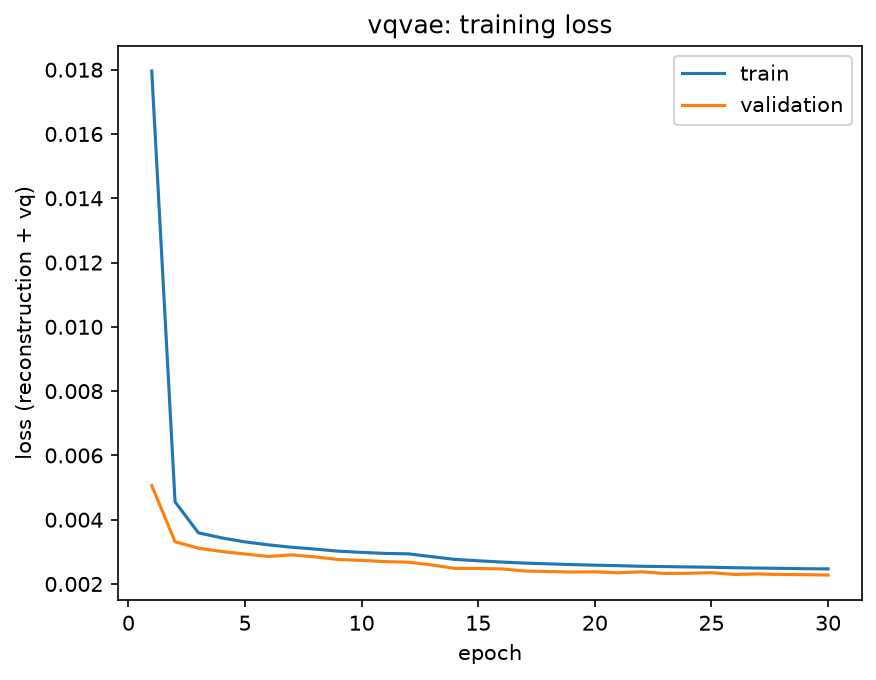
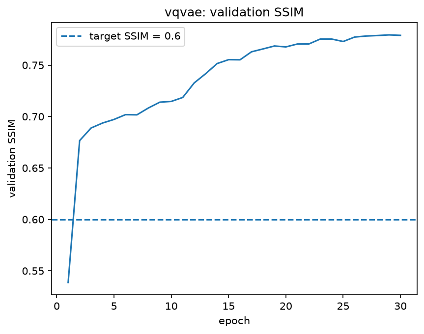
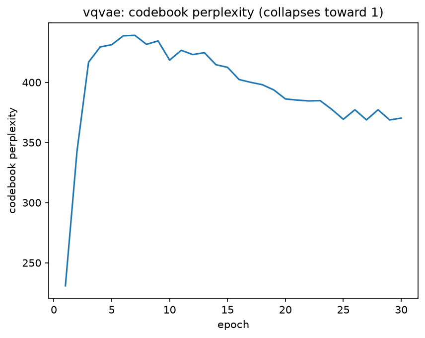
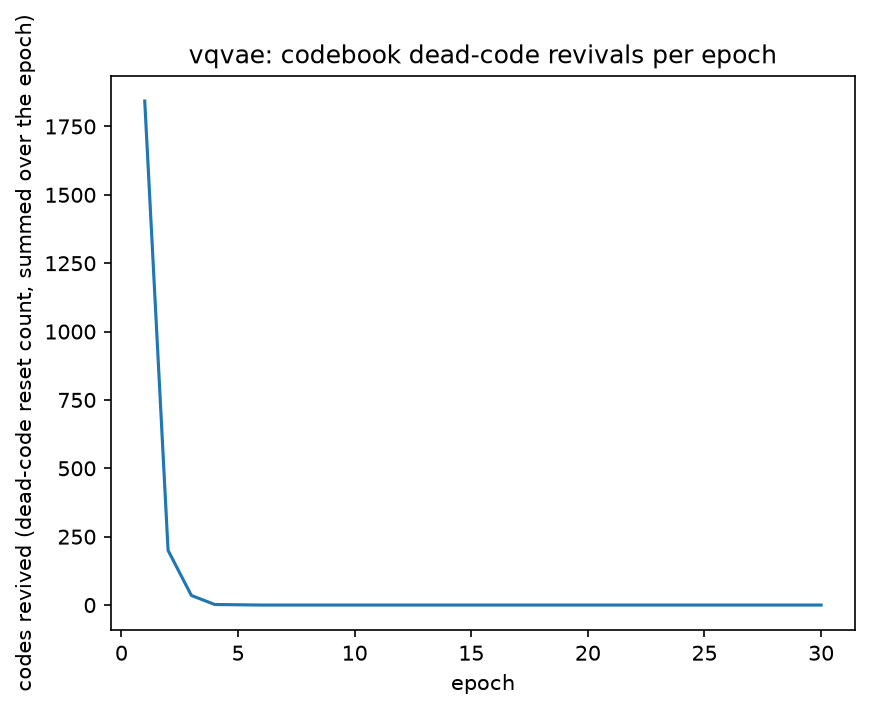

Perplexity climbs from 232 to a peak of ~437 within the first 6 epochs
(the dead-code-revival fix seeding the codebook from real encoder
outputs; see `TRAINING_LOG.md`, 2026-10-14 and 2026-10-17 entries), then
drifts gently down to ~370 by epoch 30. That gradual decline is the model
consolidating onto the codes that matter for this dataset, not collapse
-- collapse would mean a crash back toward 1, and 370/512 (~72% of the
codebook) is still healthy, broad usage. `codes_revived` confirms this
directly: it drops from 1836 in epoch 1 to effectively 0 by epoch 5 and
stays there for the remaining 25 epochs, meaning the codebook stabilised
early and never needed rescuing again.

**Autoencoder baseline**

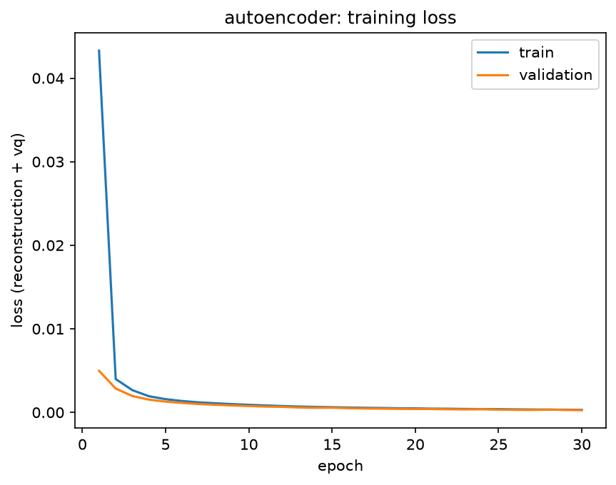
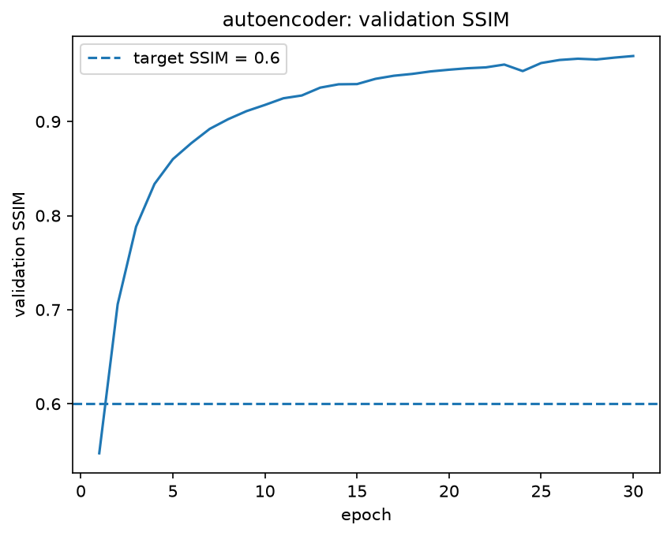
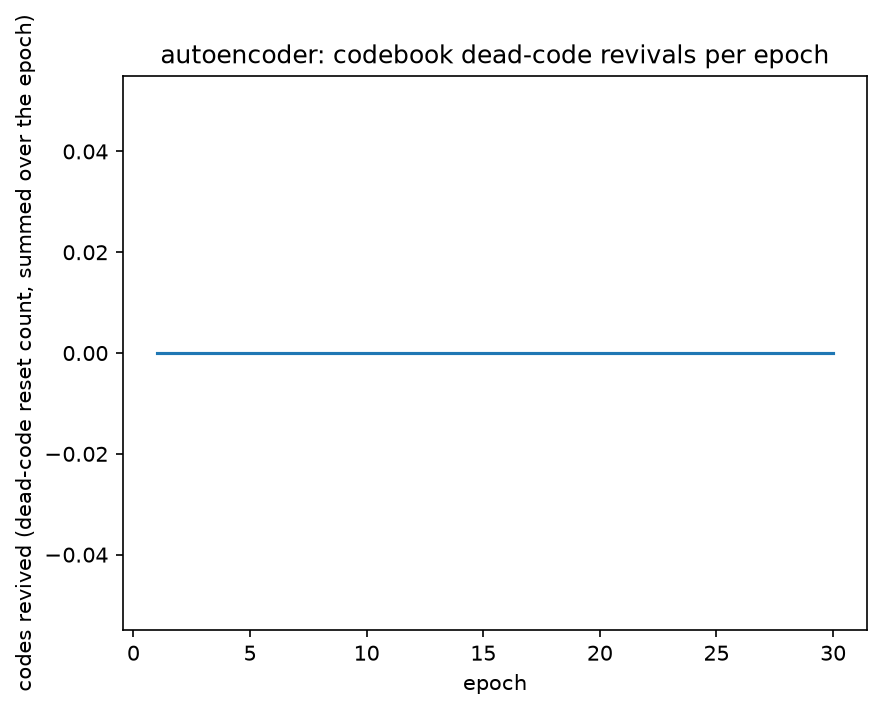

The flat-zero revived-codes curve is expected and confirms the logging
code handles the baseline's codebook-free `IdentityQuantizer` correctly
rather than silently erroring.

### Qualitative reconstructions

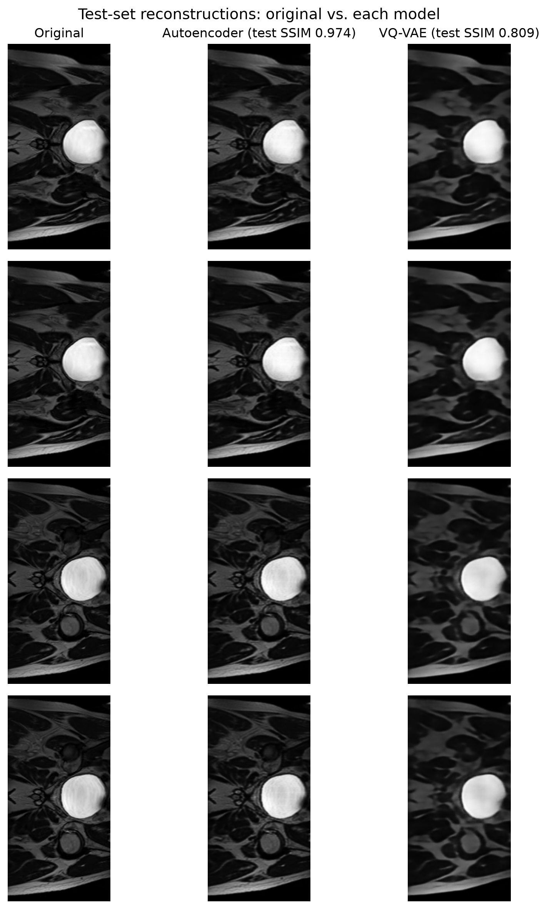

## Investigation of the Open Research Dilemma

**The dilemma:** the Results section already shows the VQ-VAE is measurably
lossier than the plain autoencoder (test SSIM 0.809 vs. 0.974). Forcing
every image through a finite, shared 512-entry codebook is a real cost.
Is it buying anything back? Specifically: does that forced bottleneck make
the VQ-VAE less able to memorise individual training patients than the
unconstrained autoencoder -- a genuine privacy argument for accepting
lower fidelity -- or is the fidelity simply lost for nothing? This section
gathers evidence rather than assuming an answer either way. All numbers
come from `dilemma.py` (full script in this folder); raw output is in
`outputs/memorisation_audit.csv` and `outputs/test_metrics.csv`
(gitignored alongside the checkpoints -- the numbers below are
transcribed exactly from them).

### Benchmarking table

| Model | Test SSIM | Test PSNR (dB) | Codebook perplexity | Memorisation signal (see below) |
|---|---|---|---|---|
| Autoencoder (baseline) | 0.9738 | 36.38 | n/a | none detected by this probe |
| VQ-VAE | 0.8090 | 27.60 | ~360/512 active | none detected by this probe |

### Resource profiling

> TODO: `seff <job_id>` for both full 30-epoch training runs (wall-clock
> time, peak memory) -- not yet collected. One concrete number already on
> record from debugging: the VQ-VAE's first attempt at a full run
> allocated 35.6GB and crashed from a gradient-tracking bug (fixed; see
> `TRAINING_LOG.md`, 2026-10-17), so the *fixed* version's real memory
> footprint is still worth recording precisely rather than assumed small.

### Memorisation audit

The most direct check: does either model do suspiciously better on a
random sample of its own training data than on the test patients it never
saw? A random, fixed-size sample of 540 training slices (matching the
test set's size, so the comparison isn't confounded by sample size) was
evaluated the same way as the test set.

| Model | Train-sample SSIM | Test SSIM | Gap (train − test) |
|---|---|---|---|
| VQ-VAE | 0.7898 | 0.8090 | **−0.0193** |
| Autoencoder | 0.9704 | 0.9738 | **−0.0034** |

Both gaps are slightly *negative* -- both models reconstruct the held-out
test set marginally better than a random training sample, not worse. A
positive gap (train performance inflated above test) is the classic
memorisation signature; neither model shows it. Read narrowly, this says
neither model is grossly overfitting to individual training images in a
way that shows up as inflated train-set SSIM.

That said, this is a weak probe, and a weak probe returning a null result
is not strong evidence of safety -- it only means *this particular test*
didn't catch anything. A model could still memorise fine-grained,
patient-identifying texture that doesn't move the aggregate SSIM gap at
all. A proper privacy audit would need a sharper tool (e.g. a
membership-inference-style test, or nearest-training-neighbour distance
correlated with reconstruction error) than the one built here, and that
is flagged explicitly as future work in the recommendation below rather
than glossed over.

**VQ-VAE-specific check: does the codebook itself generalise?** Unlike the
autoencoder, the VQ-VAE's bottleneck is a finite, shared vocabulary learned
from training patients. If describing an unseen test patient required a
visibly different mix of codes than training patients use, that would
suggest the codebook has specialised to specific training images rather
than general anatomy. `dilemma.py` compares the codebook's usage
distribution (what fraction of all encoder positions land on each of the
512 entries) between the training sample and the test set:

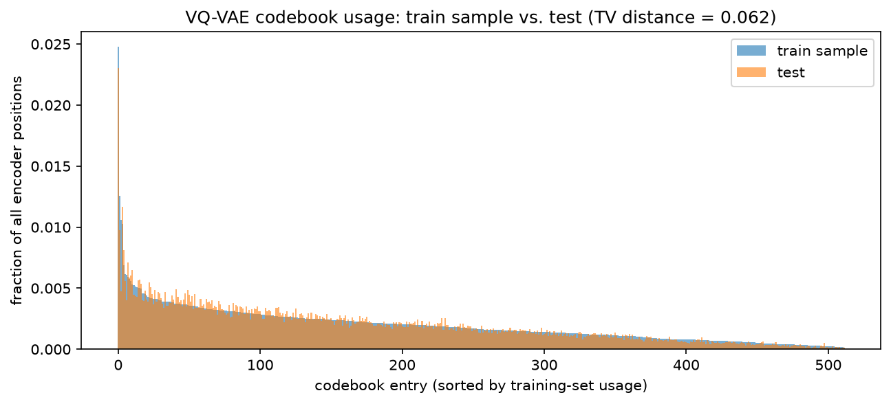

The two distributions are nearly identical (total-variation distance =
**0.062**, where 0 = identical and 1 = completely disjoint). The same
roughly 350-400 codes that describe training patients also describe test
patients, in close to the same proportions. This is a genuine point in
the VQ-VAE's favour that the autoencoder has no equivalent of: its
"vocabulary" is shared and demonstrably not patient-specific.

### Latent interpolation

Walking between two test slices in latent space and decoding every step
tests whether the learned representation is smooth and generalisable, or
just a lookup table of memorised points (which would produce garbage
between them):

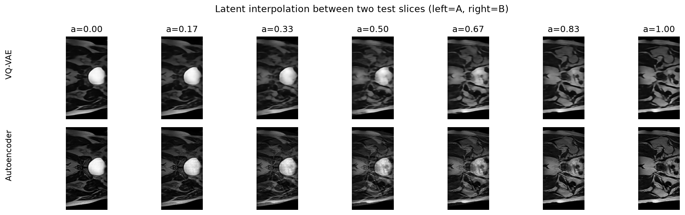

Both models produce a smooth, anatomically plausible transition -- the
bright circular structure gradually changes shape and the surrounding
tissue morphs continuously, with no sudden jumps or artefacts at any
intermediate step. This held even for the VQ-VAE, which was the more
surprising result going in: interpolating in the *continuous*
pre-quantisation space and re-quantising at every step could plausibly
have produced visible jumps whenever the interpolated point crossed from
one code's territory to another's, but the decoder appears smooth enough
across nearby codes that no such discontinuity is visible. Both models
pass this check; neither shows the "memorised isolated points" failure
mode.

### Failure-case autopsies

The 5 worst test-set reconstructions by SSIM, for each model:

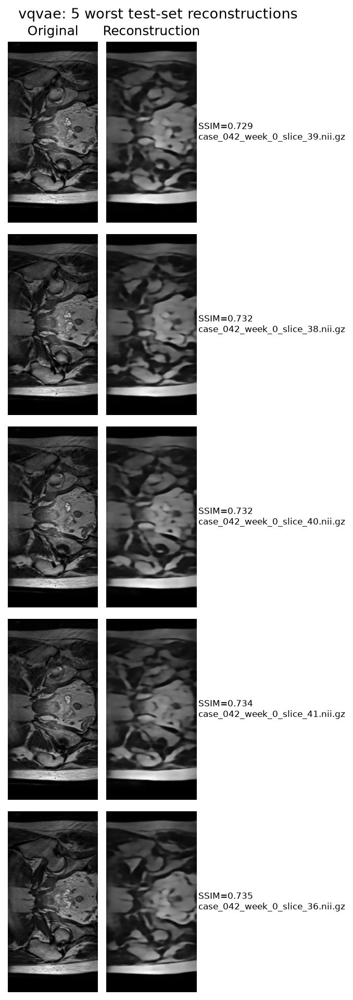
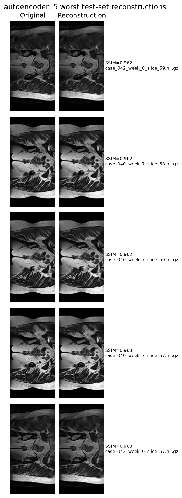

**VQ-VAE (worst SSIM 0.729-0.735):** all five worst cases are consecutive
slices (36, 38, 39, 40, 41) from a single patient, `case_042`. This is not
five independent failures -- it's one systematic weak spot. The slices
show denser, more granular internal texture than the simpler
bladder-dominated slices typical elsewhere in the dataset, and the VQ-VAE
visibly over-smooths this region, losing the fine granularity while still
preserving the overall shape and boundaries. This reads as a
*representation* limitation (this particular texture pattern is
under-represented in what the 512-entry codebook learned to describe)
rather than a random failure, which matters for the privacy argument:
a systematic blind spot on one patient's specific anatomy is a
*weaker* fidelity hit than it first looks (it is not reconstructing that
patient any better than it reconstructs anyone else -- if anything,
worse), but it also means the codebook has not specialised to memorise
that patient's detail, consistent with the audit above.

**Autoencoder (worst SSIM 0.962-0.963):** worth stating plainly -- these
are not real failures. The autoencoder's "worst" reconstructions on the
entire test set are still visually almost indistinguishable from the
originals. Its weakest cases (`case_042`/`case_040`, slices 57-59) show
fine muscle striations very slightly softened, nothing more. This itself
is informative for the dilemma: the autoencoder has essentially *no*
regime where it fails to reconstruct a patient with high fidelity, which
is exactly the property that makes its memorisation risk (even though
this audit's SSIM-gap probe didn't detect it directly) a live concern
rather than a hypothetical one -- there's no fidelity ceiling pushing back
against it anywhere in this dataset.

### Recommendation to the project manager

Neither model showed an overt memorisation signature under the tests run
here, so this is not a case of "the VQ-VAE is safe and the autoencoder is
not" -- the evidence doesn't support that strong a claim. What the
evidence does support:

1. The VQ-VAE's codebook is demonstrably shared and general (TV distance
   0.062 between train and test usage), which is a structural privacy
   property the autoencoder cannot offer by construction -- there is
   nothing analogous to audit in a free-form continuous bottleneck.
2. That structural property costs roughly 0.16 SSIM (0.974 -> 0.809) and
   is concentrated as a systematic weak spot on unusual anatomy rather
   than spread evenly, which matters if this model is ever used for
   diagnostic-adjacent purposes rather than only data augmentation.
3. The memorisation probe used here (train-vs-test SSIM gap) is a
   deliberately simple first pass, and a null result from it is weak
   evidence of safety either way.

**Recommendation:** for any deployment where reconstructions, codes, or
derived synthetic images might leave a controlled environment (shared
with collaborators, used to generate a public synthetic dataset, etc.),
prefer the VQ-VAE and treat its lower fidelity as the cost of a real,
structural privacy property rather than a pure downside. For purely
internal use where maximum fidelity matters and nothing derived from the
model ever leaves a trusted environment, the autoencoder's near-perfect
reconstruction is hard to justify giving up. Before trusting either
model's privacy properties for a real deployment, the next step should be
a sharper memorisation test than the one here -- e.g. a
membership-inference-style classifier, or correlating reconstruction
error with each test image's distance to its nearest training neighbour
-- since the simple SSIM-gap test used in this investigation is a
reasonable first check but not a strong enough one to deploy on alone.

## Artificial Intelligence Usage Disclosure

> TODO: which AI tools were used, what specific tasks they assisted with,
> and how outputs were audited/verified/tested. Mandatory, exact heading.
